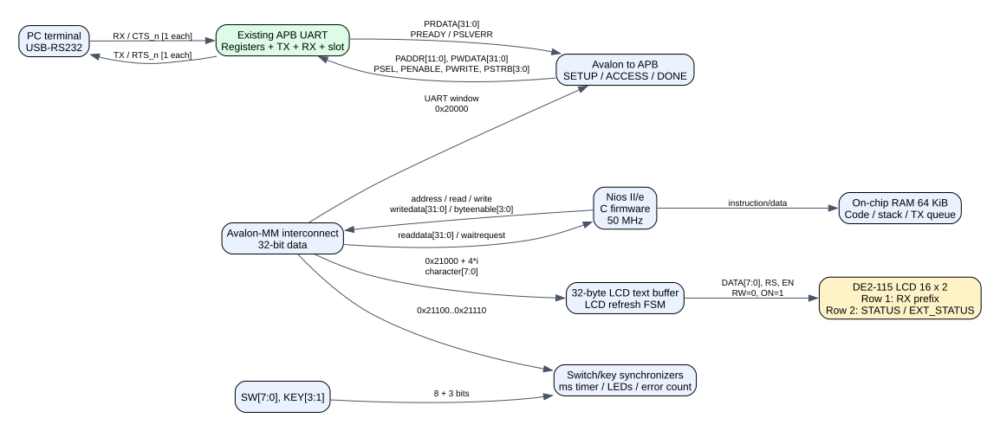

# Nios II + UART APB + LCD DE2-115

Thiết kế bổ sung ngày 12/10/2026. Đây là **profile CPU riêng**, thay RTL Echo Master bằng firmware; profile RTL cũ vẫn nằm ở `../RTL` và `../Quartus`. Không nối hai master cùng lúc vào UART. Các tài liệu cũ ghi “không Nios” mô tả profile RTL, không mô tả profile này.

## 1. Trạng thái bàn giao

- Đã viết firmware C, startup assembly, linker và build ra `firmware/build/uart_lcd.elf` cho Nios II R1.
- Đã viết RTL Verilog-2001: cầu Avalon→APB, peripheral board, bộ điều khiển LCD và board top.
- Đã kiểm thử firmware với mô hình register, mô phỏng cầu APB, tích hợp UART thật và giao thức LCD. Xem `tests/results.txt`.
- Platform Designer 24.1 đã nhận và generate HDL cho peripheral mới; xem `quartus/peripheral_check/`. Đây **không phải hệ thống CPU**.
- **Chưa generate được Nios II CPU, chưa có SOF CPU, chưa chạy trên board**: Platform Designer cài trên máy báo `No module type named altera_nios2_gen2`. Không dùng SOF UART cũ để nạp ELF này.
- Script tạo hệ thống CPU là cấu hình mục tiêu, cần chạy/kiểm tra trên bộ cài có Nios II Gen2 IP. Các tên tham số CPU phải được xác nhận bằng catalog của bộ cài đó. Chưa xác minh timing closure toàn hệ thống.

## 2. Ý tưởng thực hiện

CPU chạy chương trình liên tục trong RAM FPGA, không cần PC ra lệnh từng lần đọc/ghi. PC cần để nạp FPGA/firmware lúc thử nghiệm và là thiết bị UART gửi/nhận.

Nios II có bus Avalon-MM, vì vậy CPU **không nối trực tiếp APB**. CPU truy cập địa chỉ memory-mapped; cầu tạo SETUP rồi ACCESS của APB, chờ PREADY, trả dữ liệu cho CPU. UART vẫn là IP tự thiết kế, không thay bằng UART IP của Intel.



Đường echo:

1. PC TX → bộ RS232 có sẵn trên DE2-115 → UART RX.
2. UART ghép frame, kiểm parity/stop, giữ word và metadata trong RX slot.
3. CPU poll STATUS; khi có word, đọc EXT_STATUS trước, sau đó đọc RX_DATA để pop.
4. Word lỗi: bỏ, bật cờ lỗi. Word tốt: thêm vào hàng đợi echo RAM; cập nhật dòng LCD đầu.
5. Khi STATUS[0]=1: CPU ghi TX_DATA, rồi CTRL.START. UART tự chờ CTS và phát frame.

CPU không chờ bận trong vòng `while(TX_BUSY)`. Khi CTS chặn TX, chương trình vẫn đọc switch, cập nhật LCD và phục vụ RX đến giới hạn hàng đợi.

## 3. Phần cứng CPU mục tiêu

| Thành phần | Cấu hình |
|---|---|
| FPGA | Cyclone IV E EP4CE115F29C7 |
| Clock chung | 50 MHz CLOCK_50, không CDC giữa CPU/APB/LCD |
| CPU | Nios II Gen2 `/e` (Tiny), ISA R1, debug JTAG bật |
| RAM | On-chip RAM 64 KiB, code/data/stack chung |
| Reset vector | RAM + 0 = `0x10000` |
| Exception vector | RAM + 0x20 = `0x10020` |
| Instruction master | RAM và CPU debug memory |
| Data master | RAM, debug memory và `uart_cpu_peripheral` |
| UART | `../RTL/rtl/uart_apb_top.v`, runtime baud bật |
| LCD | Bộ điều khiển RTL 8-bit, write-only, 2×16 ký tự |
| IO | Đồng bộ 2 FF; debounce toàn vector trong firmware 20 ms |
| Timer | Counter millisecond riêng trong peripheral |
| Interrupt | Chưa dùng; polling không blocking, không HAL/RTOS |

Firmware tự chứa, không cần BSP để biên dịch. `ldwio/stwio` bảo đảm truy cập I/O; startup cấm interrupt, đặt SP/GP, xóa BSS rồi gọi main. Nếu thay CPU sang ISA R2, đổi ISA compiler và xác minh lại; không dùng ELF R1 một cách tùy tiện cho cấu hình khác.

## 4. Điều khiển trên board

| Điều khiển | Chức năng |
|---|---|
| KEY0 | Reset toàn hệ thống; firmware khởi động lại 115200, 8N1 |
| SW[1:0] | 00=5, 01=6, 10=7, 11=8 data bits, cấu hình chờ Apply |
| SW2 | 1 bật parity, 0 tắt parity |
| SW3 | Parity: 0 odd, 1 even; bỏ qua khi SW2=0 |
| SW4 | 0 một stop, 1 hai stop |
| KEY1 | Chọn baud kế tiếp cho lần Apply sau |
| KEY2 | Apply: pause RX, chờ drain echo/TX, ghi CFG/BAUD, đọc lại |
| KEY3 | Resume sau Apply; có nhớ yêu cầu nếu bấm sớm |
| SW5 | 0 xem STATUS, 1 xem EXT_STATUS ở dòng 2 |
| SW6 | Cạnh 0→1 gửi **một** báo cáo register đang chọn qua UART; phải gạt xuống rồi lên để gửi lại |
| SW7 | Cạnh 0→1 xóa vùng nội dung dòng 1; không xóa hàng đợi echo |
| LEDR0 | CPU đang boot hoặc chờ Apply/Resume |
| LEDR1 | Đã gặp lỗi; giữ đến reset |

Baud index `B0..B8`: 2400, 4800, 9600, 19200, 38400, 57600, 76800, 115200, 230400. Chữ B trên LCD chỉ **giá trị đang chọn để Apply**, không khẳng định baud active. Boot chọn B7.

Trình tự đổi cấu hình: ngừng gửi từ PC → chọn SW/KEY1 → KEY2 → chờ áp dụng và đổi terminal sang cùng format → KEY3. Nếu không drain được trong 2 giây, firmware hủy chờ Apply, bật lỗi và tiếp tục cấu hình cũ. Nó không ép UART hủy frame hay bỏ qua CTS.

KEY3 không xóa TX đang kẹt CTS. Cần kiểm tra PC RTS→FPGA CTS. UART gửi nốt frame đã bắt đầu dù CTS đổi giữa frame.

## 5. Hiển thị LCD và dữ liệu

Dòng 1 giữ **16 ký tự đầu tiên** của thông điệp hiện tại, phần dư vẫn echo đầy đủ nhưng không cuộn LCD. Ký tự ngoài ASCII in được thành dấu `.` trên LCD; echo giữ nguyên giá trị byte.

CR/LF kết thúc thông điệp. Nội dung cũ giữ đến ký tự dữ liệu tiếp theo rồi thay bằng dòng mới; CRLF không tạo hai lần xóa. Khoảng nghỉ RX ít nhất 500 ms cũng bắt đầu thông điệp mới ở byte tiếp theo. Có thể dùng SW7 để xóa thủ công. UART không có khái niệm “chuỗi hoàn tất”, vì vậy quy ước này là của firmware.

Dòng 2 ví dụ: `S:00000001 B7 R ` hoặc `E:000000C0 B7 P!`.

- S/E: STATUS/EXT_STATUS; 8 chữ số hex là giá trị đầy đủ.
- R: đang chạy; P: đang xử lý/chờ Resume. `!`: đã ghi nhận lỗi.
- CPU cập nhật buffer LCD mỗi 100 ms. RTL LCD tự refresh khoảng 170 ms/lượt, không chặn RX. Có thể thấy chuyển tiếp trong một lượt refresh; không có double-buffer LCD.
- LCD khởi tạo sau ít nhất 50 ms, EN setup/pulse ≥1 us, khoảng chờ sau lệnh 5 ms. Dùng 0x80/0xC0 để chọn hai dòng.
- LCD_RW cố định 0; không đọc busy flag. LCD_ON=1, LCD_BLON=0 theo lưu ý module không backlight trong manual DE2-115.

SW6 gửi dạng `\r\nS:0x00000001\r\n` hoặc `\r\nE:0x000000C0\r\n`. Giá trị chụp **khi SW6 được debounce**, có thể khác lúc byte cuối được phát. Báo cáo được chèn liên tiếp vào hàng đợi, không chen từng byte với echo mới. Terminal phải có 8 data bits để đọc báo cáo ASCII; ở 5/6/7 bits, yêu cầu báo cáo bị từ chối và bật lỗi, echo vẫn hỗ trợ đủ 5..8 bits.

Không có thanh ghi riêng tên TX_STATUS trong UART hiện tại: TX ready là STATUS[0], TX busy là EXT_STATUS[0], CTS là EXT_STATUS[3]. Chọn STATUS hoặc EXT_STATUS đáp ứng việc gửi tình trạng TX hiện tại.

## 6. Memory map của CPU

| CPU address | Nội dung |
|---|---|
| 0x10000–0x1FFFF | RAM 64 KiB |
| 0x20000–0x20FFF | Cửa sổ APB UART, byte offset giữ nguyên |
| 0x21000+4×i, i=0..31 | Ghi ký tự LCD ở byte thấp; i=0..15 dòng 1, 16..31 dòng 2 |
| 0x21100 | RO IO: bits[7:0]=SW, [10:8]=KEY[3:1], nút active-low |
| 0x21104 | RO millisecond counter 32-bit, wrap khoảng 49,7 ngày |
| 0x21108 | RW LEDR[1:0] |
| 0x2110C | RO số APB transfers bị PSLVERR, reset về 0 |
| 0x21110 | RO design ID `0x4E494F31` |
| 0x30000 | CPU debug memory, span do IP xác định |

LCD là write-only. Các offset local không khai báo trả 0/không ghi. UART offset không hợp lệ vẫn tạo PSLVERR theo RTL cũ. Cầu không gây CPU exception cho PSLVERR: đếm lỗi ở 0x2110C, dữ liệu trả về từ slave. Firmware kiểm tra bộ đếm và readback CFG/BAUD. Không có timeout bus mới vì UART slave hiện tại không tạo wait vô hạn sau reset.

| Offset APB | Register | Chức năng |
|---|---|---|
| 0x000 | TX_DATA | Byte staging, chưa tự phát |
| 0x004 | RX_DATA | Đọc-pop; tuyệt đối không đọc chỉ để refresh LCD |
| 0x008 | CFG | [1:0] số data bits-5; [2] hai stop; [3] parity enable; [4] even |
| 0x00C | CTRL | W1P bit0 START |
| 0x010 | STATUS | bit0 TX ready, bit1 RX valid, bit2 parity bad |
| 0x014 | EXT_STATUS | bit0 TX busy, bit1 RX busy, bit2 frame bad, bit3 CTS_n, bit4 RTS_n, bit5 RX valid, bit6 cfg_safe, bit7 runtime baud |
| 0x018 | Unmapped | PSLVERR |
| 0x01C | BAUD_SEL | index0..8, guarded |
| 0x020 | FLOW_CTRL | bit0 pause RX |

## 7. Chính sách dữ liệu và lỗi

- Hàng đợi phần mềm 512 byte; lên 384 byte thì pause RX, giảm còn ≤128 byte thì bỏ pause nếu không Apply.
- Không pop RX khi hàng đợi đầy. Dữ liệu đã enqueue không bị bỏ để ưu tiên báo cáo; thiếu 16 chỗ trống thì từ chối báo cáo, bật lỗi.
- Lỗi parity/frame không echo, không hiện vào dòng 1. LCD/LED vẫn báo đã có lỗi.
- CTS_n cao và TX busy >2 s thì bật lỗi, không tự hủy dữ liệu. Reset sẽ xóa hàng đợi và nội dung LCD.
- RX hardware vẫn chỉ có **một holding slot**. Queue CPU không biến nó thành FIFO phần cứng; adapter có thể gửi tiếp byte đã lên đường sau khi RTS đổi. Không cam kết truyền burst không mất dữ liệu ở mọi baud/adapter, đặc biệt 230400 và Nios II/e.
- Muốn stream bền vững: bước tiếp theo nên thêm RX FIFO phần cứng, ngưỡng RTS chừa chỗ cho byte đang bay; sau đó cân nhắc RX interrupt. Không âm thầm sửa IP UART trong profile này.

## 8. Tạo phần cứng và chạy firmware

### 8.1 Công cụ

Cần một bộ Quartus Lite/Standard hỗ trợ Cyclone IV **và catalog Nios II Gen2**, ví dụ kiểm tra bộ 23.1std tương ứng trước khi sử dụng. Máy hiện tại có 24.1 Lite và compiler Nios II 12.3.1 nhưng không có component CPU; thư mục runtime RTL Nios còn lại không đủ để tạo CPU mới. Không tự copy IP runtime làm CPU giả.

Không suy luận mọi edition 24.1 giống nhau: tài liệu AN1009 nói riêng việc loại Nios II trong Pro; hạn chế máy này được kiểm chứng trực tiếp bằng `tools/probe.tcl`.

### 8.2 Generate và compile

Từ PowerShell trong thư mục này:

```powershell
.\tools\generate.ps1 -QuartusRoot 'D:\intelFPGA_lite\23.1std\quartus'
.\firmware\build.ps1
```

Thay đường dẫn Quartus cho đúng bộ cài thực tế. Script đầu tạo `quartus/nios_uart_system.qsys`, generate synthesis HDL rồi compile project `uart_nios`. Script firmware hiện trỏ compiler đang có ở `D:\DATA\Quartus_lite`; có thể truyền `-ToolBin` để đổi.

Nếu tạo bằng GUI: dùng Platform Designer, tạo các instance/địa chỉ theo mục 3 và 6; CPU reset/exception chỉ vào RAM, debug enabled; instruction/data master đều nối RAM và debug memory; data master nối peripheral. Export clock, reset, conduit board. Dùng đúng tên export `clk`, `reset`, `board` để khớp board top. Không chạy auto-assign làm đổi địa chỉ rồi dùng ELF cũ.

Sau khi CPU generate được, đối chiếu SOPCINFO với linker và PERIPHERAL_BASE; xác nhận ISA R1, RAM base/size, reset vector và clock50MHz. Compile đầy đủ, xem TimeQuest và pin report. QSF có assignments board/LCD; SDC hiện chỉ khai báo clock, **chưa sign-off timing IO/reset**. Cần hoàn thiện constraint và kiểm tra các đường đồng bộ trước khi kết luận timing đạt.

### 8.3 Nạp thử bằng JTAG

1. Dùng USB-Blaster và Quartus Programmer nạp **SOF mới của `uart_nios`**. COM/CH340 không phải cổng nạp firmware Nios.
2. Mở Nios II Command Shell của bộ EDS phù hợp. Chạy trong thư mục `NIOS_LCD`:

```bash
nios2-download -g firmware/build/uart_lcd.elf
```

Nếu có nhiều cable/CPU, dùng `nios2-download --help` để chọn cable/instance đúng. Tùy bộ EDS Windows, Command Shell cần WSL; đây là công cụ vendor riêng, không cần để chạy compiler native trong build.ps1.

3. Đợi LCD có S/E và LEDR0 tắt. PC COM hiện tại: chọn cổng CH340 thực tế, 115200, 8N1, RTS/CTS.
4. Gửi `Hello FPGA` một lần, không bật local echo khi đánh giá phản hồi. Dòng 1 hiện nội dung, PC nhận echo.
5. SW5 đổi dòng 2; gạt SW6 xuống rồi lên để nhận báo cáo register.

KEY0 reset không làm mất code đã nạp RAM, nhưng mất nguồn hoặc nạp lại FPGA thì RAM mất nội dung ELF. Bản hiện tại phục vụ nạp ELF JTAG sau SOF; **chưa cung cấp ảnh flash tự boot**. Để bật nguồn chạy độc lập cần nhúng firmware vào init RAM và cấu hình flash/EPCS, build/nạp riêng sau khi test CPU thành công.

## 9. File quan trọng

| File | Nội dung |
|---|---|
| firmware/app.c | Vòng phục vụ echo, UI, LCD, config, báo cáo |
| firmware/platform.c | `ldwio/stwio` và main |
| firmware/start.S, linker.ld | Startup và bố trí RAM |
| firmware/build/uart_lcd.elf | Mã máy đã build, chưa chạy CPU thật |
| rtl/avalon_apb_bridge.v | Avalon transfer → APB SETUP/ACCESS |
| rtl/uart_cpu_peripheral.v | UART + LCD + switches + millisecond + diagnostics |
| rtl/lcd_text.v | Buffer32byte và LCD state machine |
| rtl/de2_115_nios_top.v | Nối CPU system với chân DE2-115 |
| ip/uart_cpu_peripheral_hw.tcl | Component Platform Designer |
| tools/create_system.tcl | Cấu hình CPU/RAM/interconnect mục tiêu |
| quartus/uart_nios.qsf | Project riêng và assignments |
| tests/ | Model test firmware + testbench RTL |
| docs/VALIDATION.md | Phần đã kiểm chứng và phần còn phải kiểm tra |

## 10. Tài liệu nguồn

- [Nios II Software Developer Handbook](https://www.intel.com/programmable/technical-pdfs/683525.pdf): luồng hardware/software, I/O và nạp ứng dụng.
- [Nios II Processor Reference](https://cdrdv2-public.intel.com/666887/n2cpu-nii5v1gen2-683836-666887.pdf): CPU và Avalon masters.
- [Terasic DE2-115 User Manual](https://www.terasic.com.tw/attachment/archive/502/DE2_115_User_manual.pdf): LCD16×2, pinout, RS232 và switches.
- [AN1009](https://cdrdv2-public.intel.com/839395/an-839394-839395.pdf): bảo tồn hệ thống Nios II với Quartus Pro mới; không thay thế kiểm tra catalog bộ Lite trên máy.

Đề xuất giai đoạn tiếp theo: RX FIFO + counter overrun, trang LCD xem CFG/BAUD/counter, ngắt RX, và boot từ flash. Chưa thêm các tính năng đó vào bản giao này để không làm sai register map đang có.
